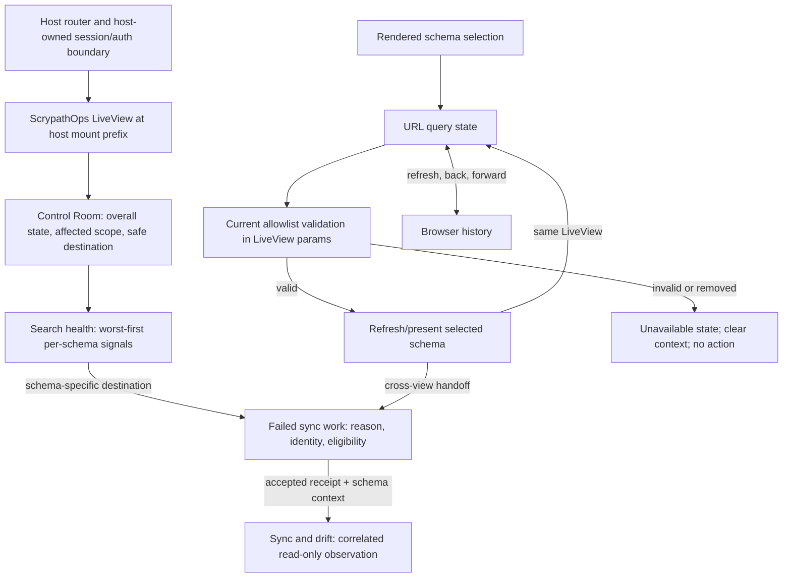

<user_constraints>
## User Constraints

Phase 174 discussion is complete in `174-CONTEXT.md`; its decisions and the repository's approved requirements bind this research and downstream planning. The maintainer authorized automatically following recommendations and keeping the approved phase moving. The recorded decisions are agent recommendations adopted under that delegation, not verbatim user selections or a simulated interview.

### Locked Decisions

- D-01: Keep Control Room concise: current state, affected scope, then one status-appropriate safe route to Search health; setup states do not imply retry.
- D-02: Keep one meaningful Search health record per schema in the established worst-first order, with full readable identity/time, plain Backend/Queue groups, and a contextual next-check link adjacent to the schema evidence.
- D-03: Put failure reason, source/work identity, attempt time, and current retry eligibility before optional diagnostics; preserve the failure record and distinguish accepted work from completed recovery.
- D-04: Carry the canonical `schema` query parameter through schema-specific recovery handoffs, refresh, and browser history; revalidate against the current allowlist and fail closed for explicit invalid/unavailable targets. Preserve existing no-parameter defaults only on generic entry pages that already use them. Invalidate schema-bound observations and pending recovery state after a selection change.
- D-05: Preserve Phase 173's neutral visual foundation, shared controls, accessibility and operational-state semantics, existing route prefixes, and host-owned authorization.
- Keep the dependency tree flat: no new dependency is recommended absent a concrete capability/correctness gap.
- Do not promote the Phase 176 Impeccable finding into Phase 174.

### the agent's Discretion

- Recommend the smallest rendered-navigation and accessibility checks that prove the requirements in the existing test lanes.
- Set exact copy, icons, responsive details, and small semantic component refinements using current source and realistic comps; do not add abstractions without a repeated need.
- Choose a compact rendered-browser proof that exercises a non-first schema selection, its real handoff, refresh, and history navigation.

### Deferred Ideas (OUT OF SCOPE)

- Phase 176 Impeccable findings and unrelated search/playbook refinements.
- New frontend dependencies, a second selection-state store, changes to host authorization, new backend abstractions, and Phase 175 repair or promotion behavior.
</user_constraints>

<phase_requirements>
## Phase Requirements

Requirement text below is copied verbatim from the current requirements source. [VERIFIED: .planning/REQUIREMENTS.md:23-26]

| ID | Description | Research Support |
|----|-------------|------------------|
| OPUX-16 | Operators entering Control Room can identify the current state, affected search scope, and next safe action in a clear reading order without duplicated explanations or competing secondary controls. | Reuse the shared posture summary; prioritize state/reason, affected scope, then one safe destination. Test all major posture/configuration states and the rendered reading order. |
| OPUX-17 | Operators inspecting Search health can scan worst-first schema records with readable complete identifiers/times, one meaningful surface per schema, and plain Backend/Queue diagnostic groups; section spacing and concise next-check actions remain clear without redundant nested containers. | Keep the current worst-first aggregate and per-schema signal model; preserve long identifiers and unknown queue observations; verify grouping and narrow reflow against the Phase 173 visual foundation. |
| OPUX-18 | Operators inspecting Failed sync work can see the failure reason, source/work identity, and recovery availability before opening verbose evidence; the common supported recovery action is discoverable while retained history, eligibility rules, and safety gates stay explicit. | Keep summary/reason/action before the compact diagnostics disclosure; retain current retry eligibility and gate checks, accepted-retry receipt, and original failure history. |
| OPUX-19 | Operators retain their selected allowed schema across rendered recovery handoffs, refresh, and back navigation after changing selection; invalid/unavailable targets cannot silently become actions on a different schema. | Make the rendered schema form and URL the selection source of truth; carry an explicit allowlisted schema through each in-journey handoff, then exercise selection, handoff, refresh, back, invalid values, and allowlist removal in mounted browser coverage. |
</phase_requirements>

# Phase 174: Recovery Entry and Diagnosis - Research

**Researched:** 2026-10-10  
**Domain:** Phoenix LiveView operator UX, URL-backed schema selection, recovery diagnosis, and accessible operational status presentation  
**Confidence:** MEDIUM

## Summary

Phase 174 should refine the existing Control Room → Search health → Failed sync work diagnosis path using Phoenix LiveView and the shared `OpsUi` components already in the app. Keep state and reason ahead of scope, then expose one obvious safe next action. Search health should keep its existing worst-first per-schema signal rows, exact identifiers and times, and separate Backend/Queue groups; Failed sync work should keep reason, source/work identity, retry availability, and retained-history status visible before its compact verbose-evidence disclosure. These patterns are supported by the current Phase 173 contract and operator UI quality rules. [VERIFIED: .planning/phases/173-shared-visual-foundation-and-operational-time/173-UI-SPEC.md:65-69; .planning/reference/OPERATOR-UI-QUALITY.md:17-26]

**Primary recommendation:** use the current query-parameter schema selection path and validate it against the live server allowlist on every rendered event and destination. Use LiveView `push_patch` for a selection change within a page and `push_navigate` for a handoff to another page; carry the selected schema explicitly through every schema-specific link. The official LiveView API documents public params as client-editable and defines `handle_params/3` for mount/patch URL changes. [CITED: https://phoenix-live-view.hexdocs.pm/1.1.33/Phoenix.LiveView.html]

The current resolver intentionally defaults an absent schema query to the first allowlisted module for a generic route, but returns unavailable for a supplied value that does not match the current allowlist. Its exact outcomes are `[] -> :setup`, `nil -> :unavailable`, and `{:ok, first}` for the absent-key branch. That distinction makes unqualified cold entry a product choice, while an in-journey handoff after a rendered selection must preserve the explicit schema. [VERIFIED: scrypath_ops/lib/scrypath_ops/operator_selection.ex:13-27; scrypath_ops/test/scrypath_ops/operator_selection_test.exs:8-20]

No new package is recommended. Existing LiveView, `OperatorSelection`, `RecoveryObservation`, status and disclosure components, ExUnit/LiveView tests, and the required mounted browser lane already cover the needed capabilities. A new dependency would add maintenance without closing a demonstrated correctness gap. [VERIFIED: scrypath_ops/mix.exs:41-60; CONTRIBUTING.md:198-199; CONTRIBUTING.md:232-240]

## Architectural Responsibility Map

| Capability | Primary Tier | Secondary Tier | Rationale |
|------------|-------------|----------------|-----------|
| Control Room state, scope, and destination hierarchy | Frontend Server (Phoenix LiveView) | Browser / Client | LiveView renders the current posture summary and links; browser rendering and focus order determine whether operators can scan and follow it. [VERIFIED: scrypath_ops/lib/scrypath_ops_web/live/control_room_live.ex:69-94; 96-129] |
| Per-schema backend/queue diagnosis | API / Backend | Frontend Server (SSR) | `ScrypathOps.Posture` aggregates the server-observed state; the LiveView presents the result and preserves unavailable observations as unknown. [VERIFIED: scrypath_ops/lib/scrypath_ops/posture.ex:46-84; scrypath_ops/lib/scrypath_ops_web/live/posture_live.ex:252-339] |
| Selection across page navigation and browser history | Frontend Server (SSR) | Browser / Client | The URL is the durable view state and LiveView routes public params through `handle_params/3`; browser history can then restore the corresponding selection. [CITED: https://phoenix-live-view.hexdocs.pm/1.1.33/Phoenix.LiveView.html] |
| Retry eligibility, authorization, and accepted-work evidence | API / Backend | Frontend Server (SSR) | Existing server code checks current selection, finds the current failed-work row, verifies recovery availability, and calls the existing sensitive-action gate. The page must not duplicate or weaken these checks. [VERIFIED: scrypath_ops/lib/scrypath_ops_web/live/failed_sync_live.ex:218-245] |
| Recovery observation receipt lookup | API / Backend | Frontend Server (SSR) | `RecoveryObservation` correlates a receipt with host, organization, schema, and generation context before exposing an observation. A URL handle is a lookup key, not proof of completion. [VERIFIED: scrypath_ops/lib/scrypath_ops/recovery_observation.ex:353-369,387-392] |
| Host identity and route authorization | Host application / edge | Frontend Server (SSR) | The local security doc says “Authentication and authorization for `/ops` are host-owned concerns:” The optional operator shell and mount-path hook must not be presented as a replacement. [VERIFIED: scrypath_ops/docs/operator-ia.md:27-39; scrypath_ops/lib/scrypath_ops_web/live/on_mount.ex:18-34] |

## Standard Stack

### Core

| Library | Version | Purpose | Why Standard |
|---------|---------|---------|--------------|
| Elixir | `~> 1.17` app requirement | Phoenix operator app and server-rendered interaction logic | Already the app's declared runtime constraint. [VERIFIED: scrypath_ops/mix.exs:4-15 — `elixir: "~> 1.17"`] |
| Phoenix | `1.8.12` locked | Router, LiveView sessions, page shell | Already used by the Phoenix 1.8 app; preserve its layouts and host route integration. [VERIFIED: scrypath_ops/mix.exs:41-51 — `{:phoenix, "~> 1.8.9"}`; scrypath_ops/mix.lock:35 — `"phoenix": {:hex, :phoenix, "1.8.12"`] |
| Phoenix LiveView | `1.1.33` locked; release metadata date `2026-08-10` | Server-rendered state, form events, query-param navigation, and browser history | It is already declared/locked and the requested version's official API documents `handle_params/3`, `push_patch/2`, and `push_navigate/2`. [VERIFIED: scrypath_ops/mix.exs:51 — `{:phoenix_live_view, "~> 1.1.33"}`; scrypath_ops/mix.lock:40 — `"phoenix_live_view": {:hex, :phoenix_live_view, "1.1.33"`; [CITED: https://hex.pm/packages/phoenix_live_view/1.1.33; https://phoenix-live-view.hexdocs.pm/1.1.33/Phoenix.LiveView.html] |
| Phoenix.Component / existing `OpsUi` | existing app code | Shared buttons, status, time, disclosure, config-empty, and navigation components | Preserve existing shared semantics and styles; the project UI contract says to extend shared components before adding near-duplicates. [VERIFIED: .planning/phases/173-shared-visual-foundation-and-operational-time/173-UI-SPEC.md:40-46; scrypath_ops/AGENTS.md:8-19] |
| ExUnit + Phoenix.LiveViewTest | existing test stack | Rendered form, event, navigation, and state contract checks | Current Control Room, Search health, Failed sync, and Sync and drift LiveView tests already exercise these boundaries. [VERIFIED: scrypath_ops/test/scrypath_ops_web/live/control_room_live_test.exs:1-10; scrypath_ops/test/scrypath_ops_web/live/posture_live_test.exs:1-10; scrypath_ops/test/scrypath_ops_web/live/failed_sync_live_test.exs:1-10] |

### Supporting

| Library or tool | Version | Purpose | When to Use |
|-----------------|---------|---------|-------------|
| Existing mounted Phoenix host + Playwright lane | existing | Verify real route prefix, rendered handoff, browser history, focus, and responsive layout | Use for cross-page schema persistence and mounted-path acceptance; this is the required `ecommerce-mounted` lane. [VERIFIED: .github/workflows/ci.yml:224-239; examples/scrypath_ecommerce/Makefile:157-161] |
| PostgreSQL test service | installed/available in this environment | Ecto-backed operator app test setup | Needed by the root operator UI verification command, which is documented as Postgres-backed and does not require Meilisearch. [VERIFIED: CONTRIBUTING.md:198-199; runtime probe 2026-10-10] |

### Alternatives Considered

| Instead of | Could Use | Tradeoff |
|------------|-----------|----------|
| URL-backed schema selection with LiveView navigation | browser local storage, session-only assigns, or custom history JavaScript | Those create a second source of truth or make refresh/back behavior depend on additional state synchronization. Keep the URL and server allowlist as the authority; no additional library is justified. [CITED: https://phoenix-live-view.hexdocs.pm/1.1.33/Phoenix.LiveView.html] |
| Existing shared `OpsUi` elements | a new component framework or per-page parallel components | A new tree would split visual and accessibility behavior during a refinement phase. Reuse the current component contract. [VERIFIED: .planning/phases/173-shared-visual-foundation-and-operational-time/173-UI-SPEC.md:40-46] |

**Installation:** None. This phase has no identified package requirement.

## Architecture Patterns

### System Architecture Diagram



The router currently places the operator routes inside a LiveView session and derives a reusable mount prefix; the host's session/auth boundary remains outside the component library's product promise. The exact route values are `live("/", ScrypathOpsWeb.ControlRoomLive)`, `live("/health", ScrypathOpsWeb.PostureLive)`, `live("/posture", ScrypathOpsWeb.PostureLive, :legacy)`, `live("/failed-sync", ScrypathOpsWeb.FailedSyncLive)`, and `live("/sync-drift", ScrypathOpsWeb.SyncDriftLive)`. [VERIFIED: scrypath_ops/lib/scrypath_ops_web/router.ex:27-35]

### Recommended Project Structure

Keep changes in the existing page and shared-component layers:

```text
scrypath_ops/lib/scrypath_ops_web/live/       # Control Room, Search health, Failed sync views
scrypath_ops/lib/scrypath_ops_web/components/ # existing OpsUi shared elements
scrypath_ops/lib/scrypath_ops/                # schema resolution and receipt/context services
scrypath_ops/test/scrypath_ops_web/live/      # rendered LiveView contracts
examples/scrypath_ecommerce/e2e/              # mounted browser proof
```

The route and LiveView files cited in the diagram are current ownership points; the shared operator UI contract maps these behaviors to existing `OpsUi` components and says to retain them. [VERIFIED: scrypath_ops/lib/scrypath_ops_web/router.ex:27-36; scrypath_ops/lib/scrypath_ops_web/live/control_room_live.ex:69-129; scrypath_ops/lib/scrypath_ops_web/live/posture_live.ex:252-384; scrypath_ops/lib/scrypath_ops_web/live/failed_sync_live.ex:594-695; .planning/phases/173-shared-visual-foundation-and-operational-time/173-UI-SPEC.md:40-46]

### Pattern 1: URL Is the Selection State

**What:** A schema choice made through a rendered selector updates the URL with LiveView patch navigation. A handoff to another LiveView uses navigate navigation and keeps the same explicit schema query. A URL update then reaches `handle_params/3`, which resolves against the current server allowlist. Phoenix documents that public params can be edited by the client and that `handle_params/3` runs on mount and live patch; `push_patch/2` updates the current LiveView and `push_navigate/2` mounts another routed LiveView. [CITED: https://phoenix-live-view.hexdocs.pm/1.1.33/Phoenix.LiveView.html]

**When to use:** Every schema change and every schema-specific recovery destination, including refresh/back restoration and mounted routes. Keep first-allowed-schema behavior only for intentionally generic cold entry, not for a link whose source has a chosen schema.

**Example:**

```elixir
# Same routed LiveView: preserve the selection in URL state.
push_patch(socket, to: current_view_path)

# A different routed LiveView: carry the selection to its URL.
push_navigate(socket, to: validated_destination_path)
```

Use the official LiveView `push_patch/2` operation for a same-view selection change and `push_navigate/2` for another routed LiveView; both keep URL state in the documented `handle_params/3` flow. [CITED: https://phoenix-live-view.hexdocs.pm/1.1.33/Phoenix.LiveView.html]

### Pattern 2: Resolve Public Schema Values Without Atom Creation

The current `OperatorSelection` source is the policy reference. Its exact values and fallback are:

> `[] -> :setup`; `[first | _] ->`; `Map.has_key?(params, "schema")`; `nil -> :unavailable`; `module -> {:ok, module}`; absent key -> `{:ok, first}`. [VERIFIED: scrypath_ops/lib/scrypath_ops/operator_selection.ex:13-27]

The selection branch is:

```elixir
case Enum.find(allowlist, &(canonical(&1) == requested)) do
  nil -> :unavailable
  module -> {:ok, module}
end
```

This is quoted from the existing resolver; keep its exact allowlist matching and failure result. [VERIFIED: scrypath_ops/lib/scrypath_ops/operator_selection.ex:17-24 — `nil -> :unavailable`; `module -> {:ok, module}`]

Its exact path encoding uses `URI.encode_query(%{"schema" => canonical(schema)})` and returns `"#{base}/#{destination}?#{query}"`. [VERIFIED: scrypath_ops/lib/scrypath_ops/operator_selection.ex:31-39]

Plan validation at the rendered boundary: select a non-first schema using the page's actual form, follow the rendered destination, confirm the URL and server-assigned schema match, refresh, then use browser back. Also try an explicit unknown value, a hostile encoded value, and a value removed from the allowlist. Invalid resolution must render unavailable, clear schema-scoped evidence, and leave recovery controls inert. Existing tests already cover absent-vs-explicit values and hostile values; add cross-view/browser proof at the user-visible seam. [VERIFIED: scrypath_ops/test/scrypath_ops/operator_selection_test.exs:8-20,51-58; scrypath_ops/lib/scrypath_ops_web/live/failed_sync_live.ex:92-127,145-169]

### Pattern 3: Keep Recovery Receipt and Observation Context-Bound

The recovery URL contains the selected schema plus a receipt handle and generation. The exact keys are `"schema"`, `"recovery"`, and `"recovery_generation"`. [VERIFIED: scrypath_ops/lib/scrypath_ops_web/live/failed_sync_live.ex:382-393]

The observation registry validates the opaque handle against the expected context, and its digest takes exactly `[:host, :org, :schema, :generation]`. [VERIFIED: scrypath_ops/lib/scrypath_ops/recovery_observation.ex:353-369,387-392 — `Map.take([:host, :org, :schema, :generation])`]

Treat the query as an untrusted request to look up evidence. Never turn a supplied handle or generation into an authorization grant, success status, or basis for a retry. If schema, host/org context, or generation is wrong or stale, keep the observation unknown/unavailable and preserve the original failed-work record. Existing async result handling is generation/handle scoped, so Phase 174 should preserve that behavior rather than widening the observation contract. [VERIFIED: scrypath_ops/lib/scrypath_ops_web/live/sync_drift_live.ex:57-99,246-269; .planning/reference/OPERATOR-UI-QUALITY.md:24-26]

### Anti-Patterns to Avoid

- **Parallel client selection state:** do not mirror the selected schema in local storage or custom JavaScript when the URL and current allowlist already provide refresh/history behavior. [CITED: https://phoenix-live-view.hexdocs.pm/1.1.33/Phoenix.LiveView.html]
- **Fallback after invalid input:** do not turn an explicit invalid or removed schema into another allowlisted schema. The current resolver distinguishes the missing-query default from explicit invalid input. [VERIFIED: scrypath_ops/lib/scrypath_ops/operator_selection.ex:17-27]
- **Treating an unobserved queue as empty:** the current Search health view renders separate copy when queue observations are absent instead of rendering counts as zero. Preserve that operational distinction. [VERIFIED: scrypath_ops/lib/scrypath_ops_web/live/posture_live.ex:313-339,489-495]
- **Receipt-as-success copy:** a retry accepted receipt identifies accepted work and leaves the source failure visible; it is not terminal evidence that the backend/index is healthy. [VERIFIED: scrypath_ops/lib/scrypath_ops_web/live/failed_sync_live.ex:649-665; .planning/reference/OPERATOR-UI-QUALITY.md:24-26]
- **Decorative nesting and repeated directions:** do not add wrapper panels or repeat the same recovery story around each schema; use heading, spacing, clear state copy, and one meaningful schema surface. [VERIFIED: .planning/phases/173-shared-visual-foundation-and-operational-time/173-UI-SPEC.md:65-69; .planning/reference/OPERATOR-UI-REFINEMENT.md:14-17]

## Don't Hand-Roll

| Problem | Don't Build | Use Instead | Why |
|---------|-------------|-------------|-----|
| Browser history and URL selection | Custom browser history hooks or local-storage selection synchronization | LiveView `push_patch/2`, `push_navigate/2`, and `handle_params/3` | The documented navigation operations already update URL/history and trigger the server's parameter path. [CITED: https://phoenix-live-view.hexdocs.pm/1.1.33/Phoenix.LiveView.html] |
| Schema identity validation | `String.to_atom/1` or a parallel parser for module names | `OperatorSelection.resolve/2` against the current schema allowlist | Existing source canonicalizes already-loaded module atoms and finds a matching allowlisted module; hostile values do not create atoms. [VERIFIED: scrypath_ops/lib/scrypath_ops/operator_selection.ex:4-28; scrypath_ops/test/scrypath_ops/operator_selection_test.exs:51-58] |
| Schema-aware handoff URLs | Per-view string concatenation that drops/duplicates query encoding | `OperatorSelection.path/3` and the current recovery path builder | Existing path construction encodes the canonical schema and incorporates the mount path. [VERIFIED: scrypath_ops/lib/scrypath_ops/operator_selection.ex:31-39; scrypath_ops/lib/scrypath_ops_web/live/failed_sync_live.ex:382-393] |
| Receipt correlation and expiration/context | A new client token format or receipt-validity cache | `RecoveryObservation` context binding and existing generation checks | Existing code already has opaque handles, context digest validation, invalidation, and stale-result filtering. [VERIFIED: scrypath_ops/lib/scrypath_ops/recovery_observation.ex:117-173,353-392; scrypath_ops/lib/scrypath_ops_web/live/sync_drift_live.ex:246-269] |
| Accessible result rows, disclosures, and action feedback | A new component package or custom disclosure behavior | Existing `OpsUi` components and native form/disclosure semantics | Shared component tests and the Phase 173 UI contract already define the interaction foundation. [VERIFIED: .planning/phases/173-shared-visual-foundation-and-operational-time/173-UI-SPEC.md:40-46; scrypath_ops/test/scrypath_ops_web/live/failed_sync_live_test.exs:152-175] |

**Key insight:** this phase's risk is coordination between visible selection, server-validated selection, and navigation history—not lack of a frontend capability. A second state mechanism would create another place where those values could diverge.

## Common Pitfalls

### Pitfall 1: Silent schema switch on an unqualified handoff

**What goes wrong:** after changing schema, an unqualified destination can be interpreted as the first allowlisted schema, so an operator can land on another target without an explicit unavailable state.

**Why it happens:** the resolver intentionally handles an absent query differently from a bad explicit query. Its exact branches include `Map.has_key?(params, "schema")`, `nil -> :unavailable`, and the absent-key result `{:ok, first}`. [VERIFIED: scrypath_ops/lib/scrypath_ops/operator_selection.ex:17-27]

**How to avoid:** carry the explicit schema from the rendered selection into each in-journey link, form patch, and recovery destination. Reserve the first-allowed default for a deliberate generic cold entry and make that entry's behavior clear. For a removed/invalid target, clear context and expose no action for the substitute schema.

**Warning signs:** browser tests pass when directly opening a URL with the second schema but fail to interact with the rendered selector; links lose a query; back changes the URL but not visible selection; refresh changes the selected row.

### Pitfall 2: Treating an action event as proof that the selected module is still allowed

**What goes wrong:** the client submits a stale or forged schema/job value after the allowlist or visible context has changed.

**Why it happens:** LiveView callback params are public input that the client can change. [CITED: https://phoenix-live-view.hexdocs.pm/1.1.33/Phoenix.LiveView.html]

**How to avoid:** validate the selection against the current server allowlist at both `handle_params/3` and action time, and derive retry details from the current failed-work row rather than trusting a submitted label or target. Preserve the existing `Gating.gate_sensitive_action` path. [VERIFIED: scrypath_ops/lib/scrypath_ops_web/live/failed_sync_live.ex:79-90,145-169,218-245]

**Warning signs:** atom creation from submitted strings; stale row IDs acting on a different schema; invalid selections leave a previous retry CTA enabled.

### Pitfall 3: Confusing accepted retry, retained failure, and completed recovery

**What goes wrong:** copy implies that retry acceptance removed the original failure or proved the live index is current.

**Why it happens:** accepted work is a queue/backend handoff, while final correctness is a separate observation. Existing UI states “Retry accepted,” identifies the replacement queue job, and says the original failure is retained; the project UI guidance explicitly distinguishes accepted from completed and unknown. [VERIFIED: scrypath_ops/lib/scrypath_ops_web/live/failed_sync_live.ex:649-665; .planning/reference/OPERATOR-UI-QUALITY.md:24-26]

**How to avoid:** keep eligibility, retained history, and the read-only next observation visible. The retry action stays behind its current checks and safety gate; verbose diagnostics remain after the common action, not before it.

**Warning signs:** a green banner on enqueue success; hiding the source failure row; treating a missing observation as verified.

### Pitfall 4: Missing configuration or unavailable observation looks healthy

**What goes wrong:** an empty allowlist, missing backend, failed status fetch, or unobserved queue is presented as zero errors or an empty queue.

**Why it happens:** empty values and unavailable values have different operational meaning. The Control Room currently has explicit `@posture.state == :unconfigured` and `@posture.state == :missing_backend` branches, and Search health only renders queue counts for observed queue state. [VERIFIED: scrypath_ops/lib/scrypath_ops_web/live/control_room_live.ex:69-94 — `@posture.state == :unconfigured`; `@posture.state == :missing_backend`; scrypath_ops/lib/scrypath_ops_web/live/posture_live.ex:313-339]

**How to avoid:** preserve distinct setup/missing-backend states and plain queue-unobserved copy. Do not manufacture success counts when the source is unavailable.

**Warning signs:** a zero metric appears after a request failure; empty-state copy does not distinguish no failed jobs from failure to load; setup actions disappear when configuration is absent.

### Pitfall 5: Long identifiers or reasons break scan order on mobile

**What goes wrong:** a long schema, index, job identity, timestamp, or failure reason is clipped, pushes page-wide horizontal overflow, or becomes impossible to copy/read.

**Why it happens:** operator identifiers are data, not decorative metadata; responsive compression can destroy the identity needed to choose a safe action. The project UI rules require wrap or an explicit accessible scroll/copy affordance and no page-wide overflow. [VERIFIED: .planning/reference/OPERATOR-UI-QUALITY.md:17-26]

**How to avoid:** retain full identity; wrap long plain text and use a bounded code surface only when intentional horizontal scrolling is clearer. Check narrow reflow and keyboard focus. W3C reflow guidance uses 320 CSS px as the benchmark except for genuine two-dimensional content. [CITED: https://www.w3.org/WAI/WCAG22/Understanding/reflow.html]

**Warning signs:** `truncate` on identity/reason fields, clipped time zone, inaccessible horizontal-only data, or a page width wider than the viewport.

## Code Examples

### Navigate while preserving public selection state

```elixir
case Enum.find(allowlist, &(canonical(&1) == requested)) do
  nil -> :unavailable
  module -> {:ok, module}
end
```

This is the current schema-allowlist lookup. Its result values are quoted verbatim above, and production code should call the existing resolver rather than copy a second implementation. [VERIFIED: scrypath_ops/lib/scrypath_ops/operator_selection.ex:17-24]

### Preserve accessible content order and state

Use native headings, labeled Backend/Queue groups, a visible action with an action-specific accessible name, and a native disclosure after the primary reason/action. Keep DOM order aligned with the operator's actual task sequence. W3C guidance supports semantic relationships and a meaningful sequence, while focus order must preserve operability. [CITED: https://www.w3.org/WAI/WCAG22/Understanding/info-and-relationships.html; https://www.w3.org/WAI/WCAG22/Understanding/meaningful-sequence.html; https://www.w3.org/WAI/WCAG22/Understanding/focus-order.html; https://www.w3.org/WAI/WCAG22/Understanding/focus-visible.html]

## State of the Art

| Old Approach | Current Approach | When Changed | Impact |
|--------------|------------------|--------------|--------|
| Keep the selected schema only in a LiveView assign or local client state | Use URL params, `handle_params/3`, and the documented patch/navigate operations; resolve public values against the current server allowlist | LiveView 1.1.33 API documents these operations; this repo already uses them. [CITED: https://phoenix-live-view.hexdocs.pm/1.1.33/Phoenix.LiveView.html; VERIFIED: scrypath_ops/lib/scrypath_ops/operator_selection.ex:11-39] | Refresh/back can reconstruct selection while invalid values remain server-checked. |
| Treat a successful retry request as successful recovery | Show acceptance and retained failure as distinct; use a later context-bound observation for verification | Current operator truth contract and implementation. [VERIFIED: .planning/reference/OPERATOR-UI-QUALITY.md:24-26; scrypath_ops/lib/scrypath_ops_web/live/failed_sync_live.ex:649-665] | Prevents operators from mistaking queue acceptance for terminal evidence. |

**Deprecated/outdated:** no dependency or framework migration is identified for this phase. Do not introduce browser-only selection, a different component system, or new success claims to express behavior already represented by existing server state.

## Project Constraints (from AGENTS.md)

- Scrypath remains an Ecto-first Elixir library with Phoenix-friendly integrations, and Meilisearch remains the v1 public backend target; do not turn this UI slice into a public multi-backend abstraction. [VERIFIED: supplied root `AGENTS.md` project constraints]
- Preserve inline, Oban-backed, and manual synchronization as distinct supported flows. Keep eventual consistency, deletion, backfill, and reindex reality explicit whenever this UI exposes those states. [VERIFIED: supplied root `AGENTS.md` project constraints]
- Keep operator setup low-friction while retaining correctness and operational clarity; preserve host-owned authentication/authorization. [VERIFIED: supplied root `AGENTS.md`; scrypath_ops/docs/operator-ia.md:27-39]
- Keep edits focused and follow the repository's `CONTRIBUTING.md` checks for changes to the optional operator app. The exact root command is `mix verify.ops_ui`; the contributor guide says it runs `cd scrypath_ops && mix deps.get && mix test` with Postgres-backed Ecto setup and no Meilisearch service. [VERIFIED: supplied root `AGENTS.md`; CONTRIBUTING.md:198-199]
- Use the existing mounted proof for mounted routes: `make -C examples/scrypath_ecommerce verify-mounted`. Its runbook calls this the local/CI parity surface and says it requires Docker Compose, publishes no host ports, and tears down its uniquely named resources. [VERIFIED: CONTRIBUTING.md:232-240]
- Keep main green and use executable test or exact-SHA hosted evidence for completion; do not substitute routine post-implementation human UAT or treat pending UAT as a completed gate. Keep subjective decisions resolved before implementation or explicitly nonblocking. [VERIFIED: supplied root `AGENTS.md` repository workflow]
- Follow the app conventions: use the Phoenix 1.8 layout and imported shared input/icon components, Tailwind/custom CSS, and no `@apply`, DaisyUI, or inline template script. Reuse `Req` if HTTP work is ever necessary. [VERIFIED: scrypath_ops/AGENTS.md:5-37]
- Do not reset, reseed, stop, or use the retained preview as disposable test data. Do not absorb unrelated dirty checkout edits into a Phase 174 plan. [VERIFIED: supplied root `AGENTS.md`; .planning/STATE.md:43-50,75-79]

## Assumptions Log

| # | Claim | Section | Risk if Wrong |
|---|-------|---------|---------------|
| A1 | Preserve existing no-parameter first-allowlisted behavior only for generic entry routes; every handoff from a selected schema must keep that exact schema explicit. [LOCKED: D-04] | Architecture Patterns; Common Pitfalls | A generated link that drops the selection could silently retarget an operator. [VERIFIED: scrypath_ops/lib/scrypath_ops/operator_selection.ex:17-27 — absent-key `{:ok, first}`; explicit invalid target is unavailable] |
| A2 | Search health's schema-level next-check links must identify the matching schema; a fleet-level generic route, if retained, is a separate intent and must be labeled as such. [LOCKED: D-02] | Architecture Patterns; Common Pitfalls | Ambiguous aggregate wording can imply that an unrelated schema's failed work is targeted. [VERIFIED: scrypath_ops/lib/scrypath_ops/posture.ex:112-123 — existing generic failed-sync route; `.planning/phases/174-recovery-entry-and-diagnosis/174-CONTEXT.md`, D-02] |

## Open Questions

1. **How should generic cold entry differ from a selected-schema recovery handoff?** Resolved: preserve the existing missing-parameter default on pages that intentionally use it, but every link emitted after a rendered schema selection must carry that schema explicitly. A supplied invalid or removed target is a visible unavailable state with no action. [LOCKED: D-04; VERIFIED: `scrypath_ops/lib/scrypath_ops/operator_selection.ex:17-27`; `.planning/phases/174-recovery-entry-and-diagnosis/174-CONTEXT.md`]
2. **How should the aggregate Search health route coexist with contextual row links?** Resolved: each schema record owns a same-schema next-check link; any aggregate destination is a separate generic route whose label must not suggest it targets the adjacent schema row. [LOCKED: D-02; VERIFIED: `scrypath_ops/lib/scrypath_ops/posture.ex:112-129`; `.planning/phases/174-recovery-entry-and-diagnosis/174-CONTEXT.md`]
3. **Are product-choice questions still blocking planning?** No. Exact copy, icon choice, responsive details, and small semantic component refinements are delegated discretion; confirm these against the current app and design contract without reopening D-01–D-05. [LOCKED: Phase 174 `174-CONTEXT.md`, `the agent's Discretion`]

## Environment Availability

| Dependency | Required By | Available | Version | Fallback |
|------------|------------|-----------|---------|----------|
| Elixir / Mix | Ops unit and rendered LiveView tests | ✓ | Elixir `1.20.4-otp-29`; Mix available | Use repository's supported CI image if compatibility-specific behavior differs. [VERIFIED: runtime probes 2026-10-10] |
| PostgreSQL | `mix verify.ops_ui` Ecto test setup | ✓ | `psql 14.17`; `pg_isready` reported accepting connections on local socket | Use existing disposable project test service; do not point tests at retained preview data. [VERIFIED: runtime probes 2026-10-10; CONTRIBUTING.md:198-199] |
| Docker / Compose | mounted browser proof | ✓ | Docker `29.5.2` | Existing required `ecommerce-mounted` CI lane. [VERIFIED: runtime probe 2026-10-10; .github/workflows/ci.yml:224-239] |
| Node / npm | optional local Playwright/browser workflow | ✓ | Node `v26.10.0`; npm `11.19.1` | Run the existing mounted lane in CI/container if local browser dependencies differ. [VERIFIED: runtime probes 2026-10-10] |
| Meilisearch | Ops UI requirements | Not required by `mix verify.ops_ui` | — | Use existing stubbed LiveView tests; the root Ops UI verification command is documented as having no Meilisearch service. [VERIFIED: CONTRIBUTING.md:198-199] |

**Missing dependencies with no fallback:** None identified.

**Missing dependencies with fallback:** None identified.

## Validation Architecture

### Test Framework

| Property | Value |
|----------|-------|
| Framework | ExUnit with Phoenix.LiveViewTest; mounted route proof uses the existing Playwright lane. [VERIFIED: scrypath_ops/test/scrypath_ops_web/live/failed_sync_live_test.exs:1-10; .github/workflows/ci.yml:224-239] |
| Config file | Existing Ops app `mix.exs` aliases; no new test framework configuration needed. [VERIFIED: scrypath_ops/mix.exs:80-105] |
| Quick run command | Focused Ops LiveView test files, then root `mix verify.ops_ui` for full operator UI tests and accessibility checks. The app alias is `"verify.opsui": ["test", "opsui.test_a11y"]`. [VERIFIED: CONTRIBUTING.md:198-199; scrypath_ops/mix.exs:86-87] |
| Full suite command | `mix verify.ops_ui`; mounted cross-route proof: `make -C examples/scrypath_ecommerce verify-mounted`. [VERIFIED: CONTRIBUTING.md:198-199,232-240 — `make -C examples/scrypath_ecommerce verify-mounted`] |

### Phase Requirements → Test Map

| Req ID | Behavior | Test Type | Automated Command | File Exists? |
|--------|----------|-----------|-------------------|-------------|
| OPUX-16 | Current state, affected scope, and one safe next destination appear in a meaningful reading order, including unconfigured/missing-backend states. | LiveView render + mounted focus/reading-order check | Focused `control_room_live_test.exs`; full `mix verify.ops_ui` | Yes; extend assertions for priority and duplicate controls. [VERIFIED: scrypath_ops/test/scrypath_ops_web/live/control_room_live_test.exs:1-10] |
| OPUX-17 | Worst-first rows retain exact identifiers/times, plain Backend/Queue groups, truthful unobserved state, and no redundant nesting; long values reflow at mobile width. | LiveView render + responsive browser/layout check | Focused `posture_live_test.exs`; `make -C examples/scrypath_ecommerce verify-mounted` for rendered mobile/layout path | Yes; add long identifier and queue-unobserved cases if not already present. [VERIFIED: scrypath_ops/test/scrypath_ops_web/live/posture_live_test.exs:1-10; .planning/reference/OPERATOR-UI-QUALITY.md:17-26] |
| OPUX-18 | Failure reason and source/work identity precede optional diagnostics; supported retry is discoverable only when allowed; original failure remains visible after acceptance. | LiveView state/action + rendered disclosure-order check | Focused `failed_sync_live_test.exs`; full `mix verify.ops_ui` | Yes; existing assertions check retry before Diagnostics, retained failure, and recovery receipt. [VERIFIED: scrypath_ops/test/scrypath_ops_web/live/failed_sync_live_test.exs:141-175; 649-676] |
| OPUX-19 | Select a non-first schema through the actual rendered selector; handoff, refresh, back/forward, and invalid/removed targets preserve or reject it without action on another schema. | LiveView render plus mounted browser history/navigation | Focused `failed_sync_live_test.exs` and `sync_drift_live_test.exs`; `make -C examples/scrypath_ecommerce verify-mounted` | Partial: rendered selection and many async/schema boundaries exist; cross-route rendered selection + refresh/back/removed-allowlist proof is still needed. [VERIFIED: scrypath_ops/test/scrypath_ops_web/live/failed_sync_live_test.exs:141-150; scrypath_ops/test/scrypath_ops_web/live/sync_drift_live_test.exs:120-128,532-538; CONTRIBUTING.md:232-240] |

### Sampling Rate

- **Per task commit:** run the focused LiveView tests for the changed surface and the focused accessibility contract where markup/focus changes.
- **Per wave merge:** run `mix verify.ops_ui` and the mounted lane if route or browser behavior changed.
- **Phase gate:** full root operator UI suite plus exact-source mounted route proof must be green before phase verification. Do not count static screenshots as interaction or URL-state proof. [VERIFIED: .planning/reference/OPERATOR-UI-QUALITY.md:32-45; .github/workflows/ci.yml:222-239]

### Wave 0 Gaps

- [ ] Add a rendered cross-screen browser sequence that changes to a non-first schema, follows the real row/action, refreshes, presses back, and confirms the same schema is selected.
- [ ] Add browser rejection proof for explicit forged/unknown and removed allowlist targets, including that no retry/recovery action remains available.
- [ ] Add a representative long schema/index/job identifier and failure reason to the narrow viewport case; assert full content can be read without document-level horizontal overflow.
- [ ] Reuse the current accessibility contract and existing mounted lane; no framework install is required. [VERIFIED: scrypath_ops/test/scrypath_ops_web/ops_a11y_contract_test.exs:1-10; examples/scrypath_ecommerce/Makefile:157-161]

## Security Domain

### Applicable ASVS Categories

OWASP identifies ASVS 5.0.0 as its current stable release and uses versioned control categories. [CITED: https://owasp.org/projects/asvs]

| ASVS Category | Applies | Standard Control |
|---------------|---------|-----------------|
| V02 Validation and Business Logic | Yes | Treat query params and LiveView event payloads as untrusted; resolve requested schema against the current allowlist; preserve retry eligibility and duplicate-action checks. [CITED: https://owasp.org/projects/asvs; VERIFIED: scrypath_ops/lib/scrypath_ops_web/live/failed_sync_live.ex:79-90,218-245] |
| V03 Web Frontend Security | Yes | Keep reason/metadata in the current normal HEEx interpolation/component path; don't introduce raw HTML. Preserve focus and accessible state for invalid targets. [CITED: https://owasp.org/projects/asvs; https://www.w3.org/WAI/WCAG22/Understanding/name-role-value.html; VERIFIED: scrypath_ops/lib/scrypath_ops_web/live/failed_sync_live.ex:628-676] |
| V08 Authorization | Yes, boundary preserved | Keep host-owned authentication and authorization wiring; the local security doc says “Authentication and authorization for `/ops` are host-owned concerns:”. The operator selection list is not identity authorization. [CITED: https://owasp.org/projects/asvs; VERIFIED: scrypath_ops/docs/operator-ia.md:27-39] |
| V07 Session Management | Boundary only | Preserve existing host session/on_mount integration; Phase 174 must not alter session or login policy. [CITED: https://owasp.org/projects/asvs; VERIFIED: scrypath_ops/lib/scrypath_ops_web/router.ex:27-36] |
| V09 Self-Contained Tokens | No new self-contained token | Recovery query handles are server-side observation lookups bound to context; do not turn them into bearer authorization. [CITED: https://owasp.org/projects/asvs; VERIFIED: scrypath_ops/lib/scrypath_ops/recovery_observation.ex:353-369,387-392] |
| V11 Cryptography | No new cryptographic design | Reuse existing context digest implementation; do not invent client-side receipt signing or a new secret/token scheme. [CITED: https://owasp.org/projects/asvs; VERIFIED: scrypath_ops/lib/scrypath_ops/recovery_observation.ex:387-392] |

### Known Threat Patterns for Phoenix LiveView Operator UI

| Pattern | STRIDE | Standard Mitigation |
|---------|--------|---------------------|
| Forged schema query/event or schema removed after render | Tampering / Elevation of Privilege | Validate against current server allowlist on param resolution and again before sensitive action; unknown values clear context and expose no action. [CITED: https://phoenix-live-view.hexdocs.pm/1.1.33/Phoenix.LiveView.html; VERIFIED: scrypath_ops/lib/scrypath_ops_web/live/failed_sync_live.ex:79-90,145-169] |
| Forged/stale receipt handle or generation | Spoofing / Tampering | Match server-side opaque handle to host/org/schema/generation context; stale/mismatched observation stays unknown and cannot assert completion. [VERIFIED: scrypath_ops/lib/scrypath_ops/recovery_observation.ex:353-369,387-392; scrypath_ops/lib/scrypath_ops_web/live/sync_drift_live.ex:57-99] |
| Retrying by trusting client-supplied work identity | Tampering | Derive the row from current server inspection and run the existing `Gating` path and recovery checks. [VERIFIED: scrypath_ops/lib/scrypath_ops_web/live/failed_sync_live.ex:218-245] |
| Failure reason or metadata treated as trusted markup | Cross-site scripting | Preserve the current HEEx interpolation of `row.reason` and keep arbitrary metadata inside the existing code-block component; do not add raw HTML rendering. [VERIFIED: scrypath_ops/lib/scrypath_ops_web/live/failed_sync_live.ex:628-676] |

## Sources

### Primary (HIGH confidence for repository source-of-truth claims)

- Phoenix LiveView 1.1.33 API - `handle_params/3`, public params, patch/navigate semantics: [official versioned docs](https://phoenix-live-view.hexdocs.pm/1.1.33/Phoenix.LiveView.html).
- Current source-of-truth for schema routing and recovery context: `scrypath_ops/lib/scrypath_ops/operator_selection.ex`, `router.ex`, `failed_sync_live.ex`, `sync_drift_live.ex`, and `recovery_observation.ex` (line citations appear beside findings).
- Phase requirements, project workflow, and UI references: `.planning/REQUIREMENTS.md`, `.planning/ROADMAP.md`, `.planning/STATE.md`, `.planning/reference/OPERATOR-UI-QUALITY.md`, `.planning/reference/OPERATOR-UI-REFINEMENT.md`, and Phase 173 `173-UI-SPEC.md` (line citations appear beside findings).
- Hex release metadata for LiveView 1.1.33: [official release page](https://hex.pm/packages/phoenix_live_view/1.1.33).

### Secondary (MEDIUM confidence for official external guidance)

- W3C WCAG 2.2 understanding documents for semantic relationships, meaningful order, visible focus, and reflow: [1.3.1](https://www.w3.org/WAI/WCAG22/Understanding/info-and-relationships.html), [1.3.2](https://www.w3.org/WAI/WCAG22/Understanding/meaningful-sequence.html), [2.4.3](https://www.w3.org/WAI/WCAG22/Understanding/focus-order.html), [2.4.7](https://www.w3.org/WAI/WCAG22/Understanding/focus-visible.html), and [1.4.10](https://www.w3.org/WAI/WCAG22/Understanding/reflow.html).
- OWASP ASVS project page - current version and category names: [OWASP ASVS](https://owasp.org/projects/asvs).
- Project-local operator IA and implementation guidance in `scrypath_ops/docs/operator-ia.md`, `scrypath_ops/AGENTS.md`, and `CONTRIBUTING.md`.

### Tertiary (LOW confidence)

- None used as authoritative guidance. Any product-choice assumptions are listed explicitly below for confirmation.

## Metadata

**Confidence breakdown:**
- Standard stack: HIGH — existing app constraints and locked versions were read from `mix.exs`/`mix.lock`, and the requested LiveView version's official documentation/release metadata were checked.
- Architecture: MEDIUM — relevant route, resolver, LiveView, and receipt sources were opened; Phase 173 is complete and Phase 174 context is present and locked.
- Pitfalls: MEDIUM — grounded in current code, versioned framework guidance, project UI rules, and Phase 174's locked decisions.

**Research date:** 2026-10-10  
**Valid until:** 2026-11-09 for stable framework/architecture recommendations; re-check if Phoenix LiveView or the Phase 173 baseline changes before planning.
