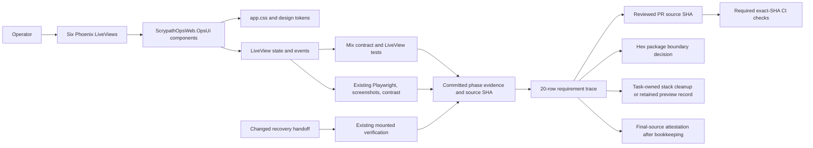

# Phase 177: Shared Patterns and Delivery Proof - Research

**Researched:** 2026-10-11  
**Domain:** Phoenix LiveView UI consistency, accessibility verification, OSS delivery evidence  
**Confidence:** HIGH for repository patterns and local verification lanes; MEDIUM for hosted evidence design, grounded in official GitHub and Hex documentation.

<user_constraints>
## User Constraints (from CONTEXT.md)

### Locked Decisions

## Implementation Decisions

The user authorized automatic follow-through on recommendations and requested broad, role-based analysis. The following are the one-pass recommended choices, synthesized across product/design, accessibility, Phoenix/LiveView engineering, QA, security, release/operations, and maintainer-review lenses. They were not individually selected through interactive questions.

### Shared six-surface vocabulary and design catalog

- **D-01:** Audit all six named surfaces against the delivered UI and existing phase evidence. Document the shared grouping, action, status, and feedback patterns that are actually demonstrated. Components with the same function should remain recognizable and consistently identified; labels and layouts may remain contextual when the task or result differs. Preserve each surface's distinct operator job and evidence semantics.
- **D-02:** Use `ScrypathOpsWeb.OpsUi`, `app.css`, and `DESIGN-TOKENS.md` as the current component/token authority. Reconcile `DESIGN.md` and the token catalog with implemented behavior, including concise examples and concrete superseded rules. Do not impose an arbitrary component count, turn every named pattern into a new component, or perform a broad redesign. If inspection finds no source drift, documentation-only consolidation is sufficient; if it finds a specific mismatch, correct only that evidenced mismatch and verify the affected behavior.
- **D-03:** Keep dependency and abstraction growth evidence-driven. Prefer the current native Phoenix/LiveView and token/component patterns; a small amount of local repetition is acceptable when a shared abstraction has no demonstrated repeated need. Add no dependency, framework, CI lane, or evidence service for catalog completeness alone.
- **D-04:** Carry forward OPUX-27's six-surface quality contract: light, dark, and System appearance; desktop and narrow widths; keyboard operation and visible focus; reduced motion; direct before/after inspection; and relevant executable layout, state, and contrast evidence for changed slices. Include mounted evidence when a recovery handoff changes. Preserve prior phase results only for their recorded source and scenarios. Do not substitute screenshots, a score, PR approval, or routine human UAT for behavioral proof.

### Requirement-level verification and delivery evidence

- **D-05:** Create one committed 20-requirement trace. For each OPUX requirement, link to its authoritative phase verification/behavior evidence and recorded source SHA, then to the reviewed PR source SHA and applicable required CI checks, recording the exact SHA each check tested. Link to existing reports rather than copying them into a second aggregate bundle. Keep local phase evidence, hosted PR evidence, and unknown/missing evidence clearly distinct.
- **D-06:** Reuse earlier evidence within its stated limits. Run Phase 177's specific checks and the existing final-source delivery gates, plus only checks invalidated by changed source. Do not rerun every prior suite solely to refresh timestamps, represent an old local pass as hosted proof, or extend v1.42's archived receipts to v1.43.
- **D-07:** Record any source mismatch or unavailable review/check as unresolved evidence; never infer requirement-level behavior from a green branch alone. Complete all plan summaries, verification/audit records, release and cleanup records before recording a final-source attestation. Keep that receipt external to the frozen source it attests.

### Release decision and task-owned cleanup

- **D-08:** Decide release/no-release from the final Hex package file set and diff. If the change remains limited to ScrypathOps and planning/design records excluded from the Hex package, record no Hex release and do not bump package version merely to finish v1.43. Reassess only if a package-included change warrants publication. The current `scrypath_ops/mix.exs` comment and root package configuration indicate ScrypathOps is excluded; verify the final package boundary at closeout.
- **D-09:** Track each task-owned disposable stack with its owner, purpose, Compose project/service/container identifiers, allocated port, collected evidence, and cleanup result/command. Remove only those disposable resources after evidence capture. Preserve the feedback preview at `http://127.0.0.1:4012/admin/search`, its volumes, and unrelated services; record that it is the normal-checkout bind mount, its owner/purpose, and its stop command. Do not treat this retained preview as evidence for the phase worktree.
- **D-10:** Do not claim OPUX-28 complete without committed requirement-level verification plus actual reviewed PR source and required CI evidence for the exact tested source. Prepare local changes and their evidence first; if hosted review or checks are unavailable, report the precise gap instead of simulating approval or weakening the criterion.

### the agent's Discretion

- Choose the concise catalog examples and the format/placement of the 20-row evidence trace, so long as the source SHA and evidence boundary are explicit for each requirement.
- Choose the smallest existing verification commands that prove changes; use repository conventions and avoid redundant checks.
- Preserve the current worktree `/Users/jon/projects/scrypath/.claude/worktrees/phase-174-recovery-entry-diagnosis` and branch `gsd/phase-174-recovery-entry-diagnosis`; keep the normal checkout and port 4012 preview untouched.

### Deferred Ideas (OUT OF SCOPE)

None — discussion stayed within the approved Phase 177 boundary.
</user_constraints>

<phase_requirements>
## Phase Requirements

| ID | Description | Research Support |
|----|-------------|------------------|
| OPUX-26 | Operators encounter the same demonstrated section/object grouping, action, status, and feedback patterns across all six surfaces; the existing component/token system owns those patterns, superseded styling is removed, and DESIGN.md plus the component/token catalog describe the delivered vocabulary without a fixed arbitrary component count. | Current `OpsUi`, CSS/token catalog, six LiveViews, and catalog contract test reveal the smallest audit/documentation seam; note the fixed-count assertion that conflicts with the requirement. |
| OPUX-27 | Operators can use the refined workflows in both themes, at narrow/desktop widths, with keyboard/focus and reduced-motion behavior intact. Each slice supplies direct before/after image inspection and relevant automated layout/state/contrast proof; changed recovery seams also receive mounted evidence in existing lanes, with no paid judge or pending routine human UAT. | Existing LiveView, Playwright, contrast, mounted, and screenshot lanes map to verification by changed slice; preserve prior source/scenario bounds. |
| OPUX-28 | Maintainers can trace every delivered requirement to committed verification and reviewed PR-first source/CI evidence, including an explicit release/no-release decision and cleanup or intentional preview retention; completion bookkeeping precedes final-source attestation and archived evidence remains within its source limits. | Existing phase verification artifacts, closeout tooling, GitHub review/check APIs, Hex package boundary, and stack cleanup script provide the trace inputs and limits. |
</phase_requirements>

## Summary

Phase 177 is primarily an audit and evidence-consolidation phase. The existing application already has one shared Phoenix function-component module, shared CSS/tokens, a catalog coverage test, and economical local, browser, contrast, and mounted checks. Audit the six named LiveViews against those authorities; add only source fixes justified by observed drift. Add the missing root `DESIGN.md` as a concise map to the implemented vocabulary, and reconcile the existing token catalog with what the views actually use. [VERIFIED: `.planning/phases/177-shared-patterns-and-delivery-proof/177-CONTEXT.md:84-100`; `scrypath_ops/lib/scrypath_ops_web/components/ops_ui.ex:1`; `scrypath_ops/assets/css/DESIGN-TOKENS.md:114-140`; `scrypath_ops/test/scrypath_ops_web/design_tokens_contract_test.exs:136-150`]

The most concrete existing mismatch is in the contract test: it asserts `assert length(exports) == 49` while the locked decision explicitly forbids an arbitrary fixed component count. Keep the dynamic check that every exported component appears in the catalog, and remove the fixed-count assumption. The planned verification trace should link the 20 OPUX rows to their local phase evidence and source SHA, then record the reviewed PR source SHA and each applicable required check's tested SHA and run link. Existing local reports are not hosted review or CI proof. [VERIFIED: `scrypath_ops/test/scrypath_ops_web/design_tokens_contract_test.exs:136-150`; `.planning/phases/177-shared-patterns-and-delivery-proof/177-CONTEXT.md:20-23,27-35`; `.planning/REQUIREMENTS.md:42-44`]

**Primary recommendation:** Keep implementation scope to the six-view audit, evidence-based corrections, `DESIGN.md` plus catalog reconciliation, a committed requirement/evidence trace, and final package/cleanup/attestation bookkeeping. Reuse existing checks and preserve port 4012. [VERIFIED: `.planning/phases/177-shared-patterns-and-delivery-proof/177-CONTEXT.md:7-10,20-41`; `CONTRIBUTING.md:26-47,67-83`]

## Architectural Responsibility Map

| Capability | Primary Tier | Secondary Tier | Rationale |
|------------|-------------|----------------|-----------|
| Six operator surfaces and their interaction state | Frontend Server (SSR) | Browser / Client | The six screens are Phoenix LiveViews; shared function components render them and LiveView owns event behavior. Preserve native controls and existing hooks. [VERIFIED: `.planning/phases/177-shared-patterns-and-delivery-proof/177-CONTEXT.md:84-100`] |
| Repeated visual vocabulary | Browser / Client | Frontend Server (SSR) | `app.css` and design tokens style the shared server-rendered component vocabulary. [VERIFIED: `.planning/phases/177-shared-patterns-and-delivery-proof/177-CONTEXT.md:68-77`; `scrypath_ops/assets/css/DESIGN-TOKENS.md:114-140`] |
| Local UI and mounted verification | Frontend Server (SSR) | Browser / Client | Mix tests exercise the Ops application and the existing browser/mounted scripts exercise rendered operator routes. [VERIFIED: `scrypath_ops/mix.exs:80-104`; `examples/scrypath_ecommerce/README.md:62-72`] |
| Requirement/PR/CI evidence trace | CI / Maintainer workflow | Repository documentation | It joins committed phase receipts to reviewed source and exact-SHA checks; GitHub review and check APIs expose the review commit and check-run head SHA. [CITED: https://docs.github.com/en/rest/pulls/reviews?apiVersion=2022-11-28#list-reviews-for-a-pull-request; https://docs.github.com/en/rest/checks/runs?apiVersion=2022-11-28#list-check-runs-for-a-git-reference] |

## Project Constraints (from AGENTS.md)

- Follow `CONTRIBUTING.md` for verification tasks, CI, and release gates; keep changes focused. [VERIFIED: `AGENTS.md:90-95`]
- Update `.planning/PROJECT.md` only when intentionally changing product scope or shipped claims. [VERIFIED: `AGENTS.md:92-95`]
- Keep main green on the lean required gates; prefer PR-first execution for serious feature-depth work. [VERIFIED: `AGENTS.md:97-100`]
- Completion requires executable tests or exact-SHA hosted evidence, never post-implementation human verification or pending UAT. Do not simulate reviewer identity or silently auto-approve trust gates. [VERIFIED: `AGENTS.md:99-101`]
- Do not reopen without an active milestone, release follow-up, or concrete bug/adopter evidence. [VERIFIED: `AGENTS.md:102-103`]

## Standard Stack

### Core

| Library/tool | Version | Purpose | Why standard |
|--------------|---------|---------|--------------|
| Elixir/Mix | App declares `~> 1.17`; repo CI uses Elixir 1.19.0 / OTP 28.1. | Ops LiveView tests and project verification aliases. | Existing project stack and CI. [VERIFIED: `mix.exs:10-15`; `.github/workflows/ci.yml:24-27`] |
| Phoenix LiveView | Ops app declares `~> 1.1.33`. | Server-rendered operator screens, event handling, and shared function components. | Existing six-surface implementation. [VERIFIED: `scrypath_ops/mix.exs:45-52`; `177-CONTEXT.md:84-100`] |
| CSS custom properties | Existing `app.css` and `DESIGN-TOKENS.md`. | Theme-aware tokens and component styling. | Current approved design authority. [VERIFIED: `177-CONTEXT.md:68-77`; `scrypath_ops/assets/css/DESIGN-TOKENS.md:114-140`] |
| Existing Playwright and contrast scripts | Existing example package scripts; no addition. | Focused browser/image and contrast checks where a changed slice needs them. | Already-established browser and accessibility lanes. [VERIFIED: `examples/scrypath_ecommerce/package.json:9-24`; `examples/scrypath_ecommerce/Makefile:138-162`] |

### Alternatives Considered

| Instead of | Could use | Tradeoff |
|------------|-----------|----------|
| Current OpsUi/token and LiveView conventions | New UI framework or generalized component package | Adds abstractions and dependency/CI surface despite locked decision to use existing patterns; no demonstrated need. [VERIFIED: `177-CONTEXT.md:20-23,84-100`] |
| Existing trace/check-run sources | New evidence service or duplicate aggregate archive | Contradicts the no-new-service decision and risks losing source/scenario boundaries; link existing receipts instead. [VERIFIED: `177-CONTEXT.md:27-35`] |

**Installation:** None. This phase should add no package or service. [VERIFIED: `177-CONTEXT.md:20-23`]

## Architecture Patterns

### System Architecture Diagram



Diagram nodes describe existing repository responsibilities and decisions from Phase 177 context. [VERIFIED: `.planning/phases/177-shared-patterns-and-delivery-proof/177-CONTEXT.md:20-41,84-100`; `CONTRIBUTING.md:67-83`]

### Six-surface audit boundary

| Surface | Source |
|---------|--------|
| Control Room | `scrypath_ops/lib/scrypath_ops_web/live/control_room_live.ex` |
| Search health | `scrypath_ops/lib/scrypath_ops_web/live/posture_live.ex` |
| Failed sync work | `scrypath_ops/lib/scrypath_ops_web/live/failed_sync_live.ex` |
| Sync and drift | `scrypath_ops/lib/scrypath_ops_web/live/sync_drift_live.ex` |
| Search | `scrypath_ops/lib/scrypath_ops_web/live/search_live.ex` |
| Playbooks | `scrypath_ops/lib/scrypath_ops_web/live/playbook_live.ex` |

These are the six audit surfaces recorded in the Phase 177 code-context and route notes; use their rendered grouping/action/status/feedback patterns as the audit unit. Preserve each surface's distinct operator task and evidence semantics. [VERIFIED: `.planning/phases/177-shared-patterns-and-delivery-proof/177-CONTEXT.md:68-77,84-100`; `scrypath_ops/lib/scrypath_ops_web/live/on_mount.ex:13-20`]

### Pattern 1: Catalog demonstrated patterns, not hypothetical components

**What:** Compare repeated grouping, action, status, and feedback behavior across the six screens; describe actual usage in `DESIGN.md` and `DESIGN-TOKENS.md`. Keep contextual labels and layouts where task/result differs. [VERIFIED: `177-CONTEXT.md:20-23,84-100`]

**When to use:** For the cross-surface audit and any source correction. If no source drift is found, documentation-only consolidation satisfies the locked scope. [VERIFIED: `177-CONTEXT.md:20-23`]

**Example check contract:** The current test discovers exports, then ensures each appears in the catalog. Retain dynamic coverage while removing the arbitrary literal count.

```elixir
# Existing contract evidence; remove the fixed-count assertion:
assert length(exports) == 49
assert missing == []
```

The quoted assertions appear in the source test at lines 143–146; the `49` threshold is the identified fixed-count mismatch. [VERIFIED: `scrypath_ops/test/scrypath_ops_web/design_tokens_contract_test.exs:136-150`]

### Pattern 2: Join proof by source, not by branch color

For each requirement, record its authoritative local report and source SHA, then the actual reviewed PR commit and applicable CI check run(s), including the exact check `head_sha`, run ID/URL, and outcome. Leave missing/unavailable evidence explicitly unresolved. GitHub's review API includes review commit identifiers, and Check Runs can be listed for a Git reference; branch protection documentation describes required reviews/status checks. [CITED: https://docs.github.com/en/rest/pulls/reviews?apiVersion=2022-11-28#list-reviews-for-a-pull-request; https://docs.github.com/en/rest/checks/runs?apiVersion=2022-11-28#list-check-runs-for-a-git-reference; https://docs.github.com/en/repositories/configuring-branches-and-merges-in-your-repository/managing-protected-branches/about-protected-branches]

## Existing Verification Lanes

| Lane | Existing use | Planning guidance |
|------|--------------|-------------------|
| Local Ops UI | Root `mix verify.ops_ui` wraps the Ops app tests; `scrypath_ops` alias includes test and accessibility checks. [VERIFIED: `lib/mix/tasks/verify.ops_ui.ex:7-20`; `scrypath_ops/mix.exs:80-104`] | Run after shared UI/contract changes; scope more focused local commands per changed behavior. |
| PR CI | Ops path-scoped job invokes `mix verify.ops_ui`; mounted job runs `mix verify.ecommerce_mounted`. [VERIFIED: `.github/workflows/ci.yml:183-242`] | Report actual workflow/run and tested SHA; do not infer it from a local pass. |
| Focused browser and screenshots | Existing `Makefile` scripts include screenshots, contrast, contrast matrix, mounted and full E2E targets. [VERIFIED: `examples/scrypath_ecommerce/Makefile:138-162`] | Inspect before/after images for changed slices and run relevant browser/state checks only. |
| Contrast | `make contrast` is the token-pair check; `make contrast-matrix` is an existing broader browser lane. [VERIFIED: `examples/scrypath_ecommerce/Makefile:138-155`; `examples/scrypath_ecommerce/contrast-checker.mjs:1-20`] | Run relevant contrast proof when colors/tokens change; avoid adding another checker. |
| Mounted recovery | `make verify-mounted` is a focused existing mounted lane and publishes no host ports; the script records artifacts then removes its own generated Compose project. [VERIFIED: `examples/scrypath_ecommerce/README.md:62-72`; `examples/scrypath_ecommerce/scripts/verify-e2e.sh:25-66`] | Required when a recovery handoff changes; use the existing task-owned cleanup pattern. Do not run broad full `verify-e2e` solely to refresh history. |
| Final-source closeout | `CONTRIBUTING.md` names the exact-SHA closeout command and requires required jobs, coverage, and closeout attestation. [VERIFIED: `CONTRIBUTING.md:67-83`] | Do final bookkeeping before attestation; no tracked writes after successful final-source run. |

The closeout helper's exact required job list is `const REQUIRED_CHECKS = ["core (required)", "package (required)", "repository-contracts (required)", "backend (required)", "ecommerce-mounted (required)"];` and its readiness list includes `"coverage (advisory)"` and `"closeout-attestation"`. Keep these recorded names exact in trace/closeout artifacts. [VERIFIED: `scripts/ci_monitor.cjs:13-20`]

## Evidence Boundaries and Release/Cleanup

- Existing Phase 173–176 verification artifacts are local, source/scenario-bound evidence; reuse them for their covered requirement behavior without claiming they are Phase 177, hosted, or current-SHA proof. Phase173 records final source `b12a7c47157b4fb88b05237b7e2525d11896fd59`; Phase174 records `2375f6b71f57037e9e636ae060828e26f59a82c6`; Phase175 validation records `fdaf9b8` (resolved locally to `fdaf9b8752e45b17ed80f3ceaa6a9c28b741573a`); Phase176 records `3cc55bdcf7b6e6bcd06572dd17c9be9ab31d7dd2`. [VERIFIED: `.planning/phases/173-shared-visual-foundation-and-operational-time/173-VERIFICATION.md:175-206`; `.planning/phases/174-recovery-entry-and-diagnosis/174-VERIFICATION.md:135-141`; `.planning/phases/175-repair-and-verification/175-VALIDATION.md:85`; `git rev-parse fdaf9b8`; `.planning/phases/176-search-and-playbooks/176-VERIFICATION.md:51-55,126-130`]
- Phase176 records focused browser `admin_surface_depth` 38/38 and a broader `docker-full` run with 61 unexpected results. Do not characterize broad E2E as passing; keep proof at the recorded lane/source boundary. [VERIFIED: `.planning/phases/176-search-and-playbooks/176-VERIFICATION.md:51-55,118-130`]
- Root Hex package configuration has a `files` allow-list that excludes the separate `scrypath_ops/` app and omits root `DESIGN.md` / `.planning/`; quote: `files: ~w(lib .formatter.exs mix.exs README.md CONTRIBUTING.md ARCHITECTURE.md CHANGELOG.md LICENSE SECURITY.md guides docs/jtbd-gap-map.md docs/releasing.md docs/operator-support.md docs/search-backend-sre.md docs/local-demo-docker-dx),`. Re-evaluate from the final file list; if scope remains excluded, document no Hex release and no version bump. Hex's publishing guide identifies package `files` as controlling included files and describes inspecting the package contents before publishing. [VERIFIED: `mix.exs:265-279`; CITED: https://hex.pm/docs/publish]
- The retained feedback preview is `http://127.0.0.1:4012/admin/search`; current STATE associates it with Compose project `scrypath-ui-v142` and container `scrypath-ui-v142-web-1`, and provides `COMPOSE_PROJECT_NAME=scrypath-ui-v142 WEB_PORT=4012 docker compose -f compose.yaml -f compose.dev.yaml down` as the stop command. Do not run that command: record ownership/purpose and preserve it and its volumes. Current probe did not observe a listener/container in this agent environment, so availability is not established here. [VERIFIED: `.planning/STATE.md:75-79`; environment probe `lsof -iTCP:4012`, `docker ps`]
- Use a task-owned stack ledger with owner, purpose, Compose project/service/container IDs, port, evidence location, and cleanup result. The existing E2E helper uses a unique generated Compose project and removes only that project after evidence capture. [VERIFIED: `177-CONTEXT.md:33-35`; `examples/scrypath_ecommerce/scripts/verify-e2e.sh:25-66`]

## Don't Hand-Roll

| Problem | Don't build | Use instead | Why |
|---------|------------|-------------|-----|
| Export/catalog coverage | A fixed component count or parallel inventory | Existing dynamic export discovery and catalog coverage, adjusted to avoid a literal count | It already checks the real export list against catalog entries. [VERIFIED: `design_tokens_contract_test.exs:136-150`] |
| Theme/contrast proof | New dependency or bespoke color analyzer | Existing token-pair `make contrast` and existing browser `contrast-matrix` | Existing lanes cover token and rendered combinations. [VERIFIED: `Makefile:138-155`; `contrast-checker.mjs:1-20`] |
| Mounted-stack cleanup | Global `docker compose down` / system prune | Existing unique project naming and project-scoped cleanup | Preserves the retained preview and unrelated services. [VERIFIED: `verify-e2e.sh:25-66`; `177-CONTEXT.md:33-41`] |
| Hosted evidence aggregation | New CI service or copied duplicate archive | One committed trace linking existing reports and exact SHA-bound GitHub check/review evidence | Explicit locked decision; GitHub APIs already expose the join fields. [VERIFIED: `177-CONTEXT.md:27-35`; CITED: https://docs.github.com/en/rest/checks/runs?apiVersion=2022-11-28#list-check-runs-for-a-git-reference] |

## Common Pitfalls

1. **Treating a screenshot as behavior proof.** Screenshots support direct comparison but do not replace layout/state/contrast tests or mounted verification when recovery behavior changes. [VERIFIED: `177-CONTEXT.md:27-35`]
2. **Using prior passes as universal proof.** Each old result has a specific source and scenario; link to the report and state its boundary rather than refreshing every lane or extending v1.42 artifacts to v1.43. [VERIFIED: `177-CONTEXT.md:27-35`; Phase173–176 verification artifacts cited above]
3. **Treating a green branch as requirement-level proof.** Capture PR review commit and exact tested SHA for each applicable check; keep unknown review/check status unresolved. [VERIFIED: `177-CONTEXT.md:27-35`; CITED: GitHub PR review and Check Runs APIs above]
4. **Turning patterns into component-count work.** Existing test hard-codes 49 exports; retain the dynamic catalog contract, drop that count, and add no new component merely to satisfy a tally. [VERIFIED: `design_tokens_contract_test.exs:136-150`; `177-CONTEXT.md:20-23`]
5. **Cleaning up someone else's state.** The port 4012 preview is explicitly retained; clean only disposable project stacks owned by Phase 177 and keep evidence before cleanup. [VERIFIED: `177-CONTEXT.md:33-41`; `.planning/STATE.md:75-79`]

## State of the Art

| Existing approach | Phase 177 application | Impact |
|-------------------|-----------------------|--------|
| Per-screen terminology and visual grouping | Document repeated demonstrated patterns in current shared OpsUi/token vocabulary while preserving contextual labels and operator tasks. | Consistent identification without flattening distinct work. [VERIFIED: `177-CONTEXT.md:20-23`; CITED: https://www.w3.org/WAI/WCAG22/Understanding/consistent-identification] |
| Branch-level green status | Requirement rows linked to reviewed PR commit and exact check-run SHA | Auditable evidence joins by source rather than inference. [CITED: GitHub protected branches, PR review, and Check Runs documentation above] |
| Phase-local receipts | Link historical receipts within their documented source/scenario limits; add Phase 177 proof and v1.43 closeout records | Avoids replaying complete suites or overstating archived evidence. [VERIFIED: `177-CONTEXT.md:27-35`] |

## Assumptions Log

| # | Claim | Section | Risk if wrong |
|---|-------|---------|---------------|
| A1 | No renderer-level source drift exists until the six views are visually inspected; documentation-only work is sufficient only if that inspection confirms no mismatch. | Summary / audit | Could miss a real visual inconsistency; plan must audit before deciding scope. |
| A2 | The preview's absence from current local probes reflects environment visibility/state, not a changed retention decision. | Evidence boundaries | Improper startup or cleanup could interfere with user preview state; preserve according to context regardless. |

## Open Questions

1. **Which exact shared patterns differ across the rendered six views?** Source inventory alone cannot establish visual consistency. Inspect light/dark and desktop/narrow before/after renders; make source changes only for observed mismatch. [ASSUMED]
2. **Which hosted PR review and required checks exist for the final phase source?** This research did not query an actual PR/run. Resolve from actual review/check records when closing out; if unavailable, record the precise gap. [VERIFIED: `177-CONTEXT.md:27-35`; live PR/check evidence not observed]

## Environment Availability

| Dependency | Required by | Available | Version | Fallback |
|------------|-------------|-----------|---------|----------|
| Node/npm | Existing browser and contrast lanes | Yes | Node `v26.10.0`; npm `11.19.1` | — [VERIFIED: environment version probe] |
| GitHub CLI | Optional hosted evidence inspection | Yes | `2.101.0` | GitHub API/UI evidence; do not assume credentials or hosted evidence. [VERIFIED: environment version probe] |
| Docker / Compose | Existing mounted/browser stack lanes | Yes | Docker `29.5.2`; Compose `v5.1.3` | Existing local-only checks where a mounted stack is not needed. [VERIFIED: environment version probe] |
| Elixir/Mix | Local Ops verification | Not selected in current shell | `mix --version` reports “No version is set for command mix”; installed Elixir shims were listed but none selected. | Select repo-appropriate version through existing tool-version configuration before running Mix. [VERIFIED: environment probe] |
| Port 4012 preview | Retained preview context | Not observed by current probe | No listener/container observed | Leave untouched; do not infer it is safe to reclaim. [VERIFIED: `STATE.md:75-79`; environment probe] |

## Validation Architecture

Nyquist validation is enabled (`workflow.nyquist_validation` is `true`). [VERIFIED: `.planning/config.json:19`]

### Test Framework

| Property | Value |
|----------|-------|
| Framework | ExUnit / Phoenix LiveView tests; Playwright for existing browser lanes. [VERIFIED: `scrypath_ops/mix.exs:80-104`; `examples/scrypath_ecommerce/package.json:9-24`] |
| Config file | Existing project config and aliases; no new framework/config needed. [VERIFIED: `scrypath_ops/mix.exs:80-104`] |
| Quick run command | `mix verify.ops_ui` for Ops UI contract and test coverage. [VERIFIED: `CONTRIBUTING.md:26-42`; `lib/mix/tasks/verify.ops_ui.ex:7-20`] |
| Full / additional commands | `make contrast`; `make contrast-matrix` for relevant changed visuals; `make verify-mounted` for a changed recovery handoff; final exact-SHA closeout per CONTRIBUTING. [VERIFIED: `Makefile:138-162`; `CONTRIBUTING.md:67-83`] |

### Phase Requirements → Test Map

| Req ID | Behavior | Test type | Automated command/evidence | File exists? |
|--------|----------|-----------|----------------------------|--------------|
| OPUX-26 | Shared grouping/action/status/feedback and catalog describes demonstrated system | ExUnit contract plus focused LiveView tests; direct visual audit | `mix verify.ops_ui`; retain dynamic export/catalog check; visual inspect all changed screens | ✅ contract exists; new source tests only if audit finds an unguarded behavior |
| OPUX-27 | Themes, widths, keyboard/focus, reduced motion; slice-level layout/state/contrast; mounted recovery if changed | ExUnit + relevant existing Playwright, screenshot, contrast and mounted lanes | `mix verify.ops_ui`; then focused existing Make target(s), `make contrast` / `contrast-matrix`; `make verify-mounted` only for changed recovery seam | ✅ lanes exist |
| OPUX-28 | Requirement trace, release decision, cleanup/preview retention, final-source attestation | Artifact/schema/content validation plus exact-SHA hosted evidence | Existing `node scripts/ci_monitor.cjs closeout --push --branch "$(git branch --show-current)" --sha "$(git rev-parse HEAD)"` after final bookkeeping; actual PR review/check evidence | ✅ closeout exists; trace is phase deliverable |

### Sampling Rate and Gaps

- After Ops UI or contract edits, run the focused relevant tests and `mix verify.ops_ui`; run only visual/accessibility/mounted lanes invalidated by changed source.
- Before completion, record PR review and exact-SHA required check results, release decision, cleanup ledger, and then run the documented final-source closeout. [VERIFIED: `CONTRIBUTING.md:67-83`; `177-CONTEXT.md:27-35`]
- **Wave 0 gaps:** No new test framework or dependency is needed. Create the required trace and root `DESIGN.md`; visually inspect surfaces before selecting source changes. The existing test's fixed-count assertion is the one concrete test-contract correction identified. [VERIFIED: `177-CONTEXT.md:68-77`; `design_tokens_contract_test.exs:136-150`]

## Security Domain

No new authentication, session, access-control, input-handling, or cryptographic behavior is in scope; this phase audits an existing operator UI and evidence workflow. Preserve the current access-control and safe-action behavior while inspecting screens. [VERIFIED: `177-CONTEXT.md:7-10,84-100`]

| ASVS area | Applies | Research guidance |
|-----------|---------|-------------------|
| Authentication / session management | No phase change | Do not alter auth/session pathways; regression-test only if an evidenced correction touches them. [VERIFIED: `177-CONTEXT.md:7-10`] |
| Access control | Existing invariant | Keep operator visibility and action safety intact; include focused regression proof for any touched path. [VERIFIED: `177-CONTEXT.md:7-10,84-100`] |
| Input validation / cryptography | No new domain behavior | Avoid scope expansion; use existing implementation and tests if touched. [ASSUMED] |

## Sources

### Primary repository evidence

- Phase 177 context, requirements, state, roadmap, and AGENTS.md: scope, constraints, status, and evidence boundaries. [VERIFIED: cited inline]
- `OpsUi`, token catalog, CSS, and contract test: current shared component/token implementation and the fixed-count mismatch. [VERIFIED: cited inline]
- `CONTRIBUTING.md`, Mix aliases, CI workflow, closeout monitor, example Makefile and scripts: existing local/hosted/browser/contrast/mounted/cleanup lanes. [VERIFIED: cited inline]
- Phase173–176 verification artifacts: historical source/scenario-limited evidence. [VERIFIED: cited inline]

### Official external documentation

- [CITED: https://docs.github.com/en/rest/pulls/reviews?apiVersion=2022-11-28#list-reviews-for-a-pull-request] — review commit evidence.
- [CITED: https://docs.github.com/en/rest/checks/runs?apiVersion=2022-11-28#list-check-runs-for-a-git-reference] — check runs joined to a Git reference and tested head SHA.
- [CITED: https://docs.github.com/en/repositories/configuring-branches-and-merges-in-your-repository/managing-protected-branches/about-protected-branches] — protected branch review/check requirements.
- [CITED: https://hex.pm/docs/publish] — package file inclusion and publishing inspection.
- [CITED: https://www.w3.org/WAI/WCAG22/Understanding/consistent-identification] — consistent identification for repeated components while allowing contextual distinctions.

## Metadata

**Confidence breakdown:**
- Standard stack: HIGH — read from current Mix/CI configuration and project context.
- Architecture: HIGH — current component, CSS, LiveView, test, and workflow sources inspected.
- Pitfalls: HIGH for current repository evidence boundaries; MEDIUM for external GitHub/Hex/WCAG guidance from official sources.

**Research date:** 2026-10-11  
**Valid until:** 2026-11-10; hosted check configuration and external documentation should be rechecked at execution/closeout.
